# AULA 08

Para consultar produtos de uma categoria:

```sql
SELECT nome, preco FROM produtos
WHERE categoria = 'Monitores';
```
O que retorna:

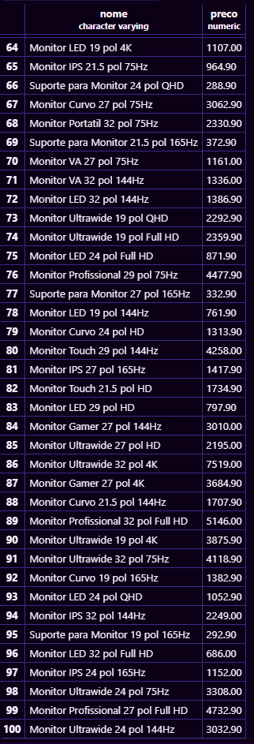

Para consultar produtos com estoque menor que 5:

```sql
SELECT nome, categoria, estoque FROM produtos
WHERE estoque < 5;
```
O que retorna:

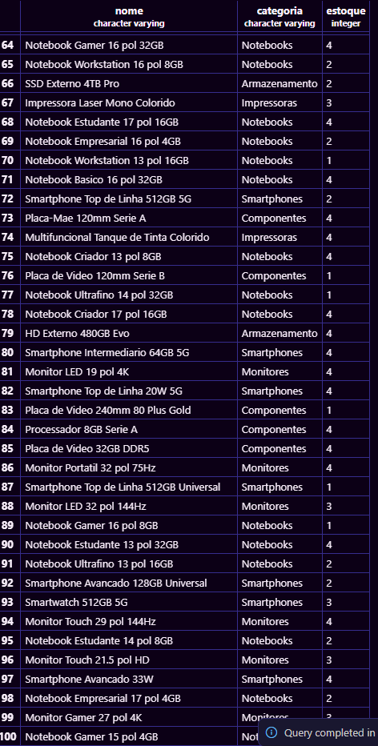

Para mostrar os 10 produtos mais caros:

```sql
SELECT nome, preco FROM produtos
ORDER BY preco DESC
LIMIT 10;
```
O que retorna:

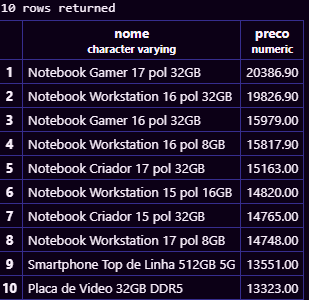

Para consultar produtos da marca Logitech em ordem de preço:

```sql
SELECT nome, preco FROM produtos
WHERE marca = 'Logitech'
ORDER BY preco ASC;
```
O que retorna:

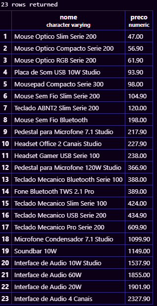

Para consultar produtos com preço entre 100 e 500:

```sql
SELECT nome, preco FROM produtos
WHERE preco BETWEEN 100 AND 500;
```
O que retorna:

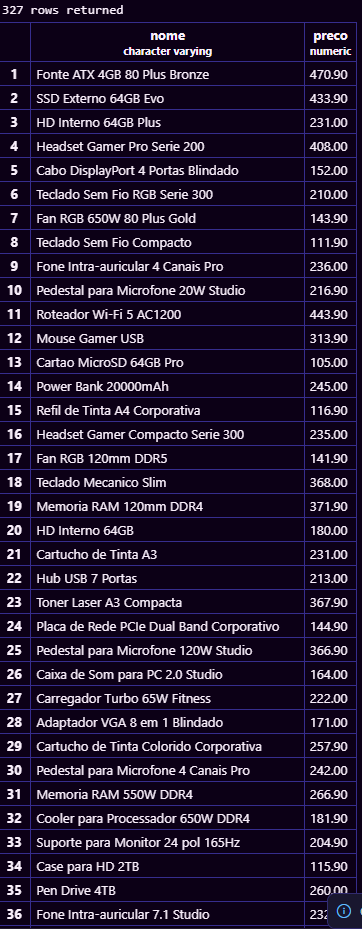

Para contar a quantidade de produtos:

```sql
SELECT COUNT(*) AS total_de_produtos FROM produtos;
```
O que retorna:

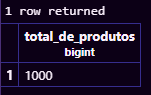

Para contar os produtos com estoque menor que 10:

```sql
SELECT COUNT(*) AS produtos_em_falta FROM produtos
WHERE estoque < 10;
```
O que retorna:

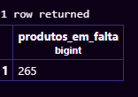

Para mostrar o maior e o menor preço:

```sql
SELECT MAX(preco) AS maior_preco,
MIN(preco) AS menor_preco
FROM produtos;
```
O que nos retorna:

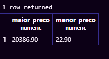

Para calcular o preço médio dos notebooks:

```sql
SELECT ROUND(AVG(preco), 2) AS preco_medio
FROM produtos
WHERE categoria = 'Notebooks';
```
O que nos retorna:

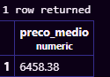

Para somar todas as peças do estoque:

```sql
SELECT SUM(estoque) AS total_de_pecas FROM produtos;
```
O que nos retorna:

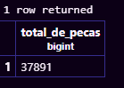

Para consultar um resumo geral do estoque:

```sql
SELECT COUNT(*) AS total_de_produtos,
ROUND(AVG(preco), 2) AS preco_medio,
MAX(preco) AS maior_preco,
MIN(preco) AS menor_preco,
SUM(estoque) AS total_de_pecas
FROM produtos;
```
O que nos retorna:

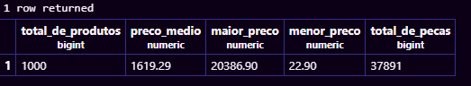

Para calcular o valor dos produtos em estoque:

```sql
SELECT nome, preco, estoque,
preco * estoque AS valor_em_estoque
FROM produtos
ORDER BY valor_em_estoque DESC
LIMIT 5;
```
O que no retorna:

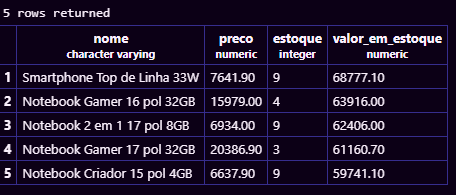

O `AS` serve para dar um nome para o resultado de uma coluna.

```sql
SELECT COUNT(*) AS total_registros FROM produtos;
```
O que nos retorna:

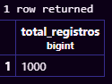

O `ORDER BY` organiza os resultados e o `LIMIT` limita a quantidade mostrada.

```sql
SELECT nome, preco FROM produtos
ORDER BY preco DESC
LIMIT 10;
```
O que nos retorna:

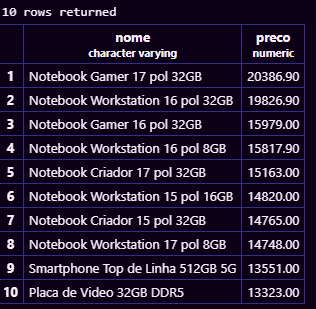
