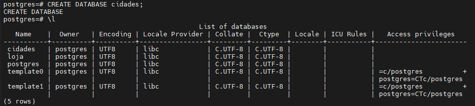
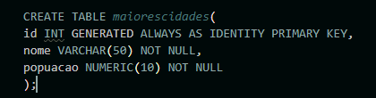
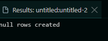
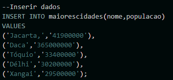
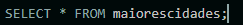
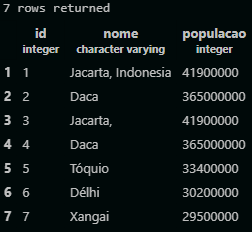

## Criação do Banco de Dados Cidades

# 1. Criação e verificação do banco de dados
  #### Ultiza-se os comandos:
  Para criar o banco de dados:
  ```sql
CREAT DATABASE cidades/
```
 Para conferir se o mesmo foi criado:
 ```sql
 \l
 ````



---
# 2. Criando a Tabela

### Dentro do Banco de Dados:

## 2.1- Iremos criar uma tabela com as colunas:

-ID;

-Nomes;

-População;
 
### Para isso, ultilizamos:


### O que gera a response:


## 2.2- Após isso precisamos inserir os valores na nossa tabela.

### Para isso, ultilizamos:


## 2.3- Agora temos que pegar esses valores, com:


# Com isso, chegamos no resultado:


#### Assim finalizamos nosso Banco de Dados de Cidades!