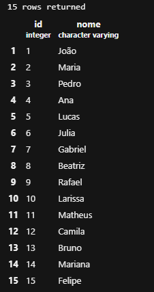
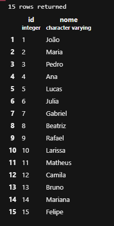
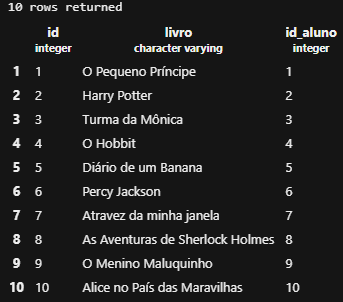
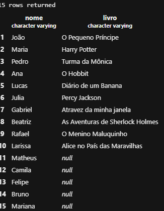
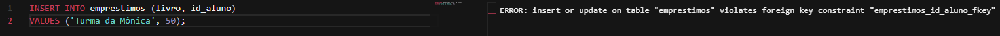

# ATIVIDADE – JOIN NA BIBLIOTECA DA ESCOLA

## PARTE 1 – MONTAR O BANCO

Primeiro foram criadas as tabelas `alunos` e `emprestimos`.

```sql
CREATE TABLE alunos (
    id SERIAL PRIMARY KEY,
    nome VARCHAR(100) NOT NULL
);

CREATE TABLE emprestimos (
    id SERIAL PRIMARY KEY,
    livro VARCHAR(100) NOT NULL,
    id_aluno INTEGER REFERENCES alunos(id)
);
```

### Cadastro dos alunos

```sql
INSERT INTO alunos (nome) VALUES
('João'),
('Maria'),
('Pedro'),
('Ana'),
('Lucas'),
('Julia'),
('Gabriel'),
('Beatriz'),
('Rafael'),
('Larissa'),
('Matheus'),
('Camila'),
('Bruno'),
('Mariana'),
('Felipe');
```


### Cadastro dos empréstimos

Foram cadastrados 10 livros, deixando 5 alunos sem nenhum empréstimo.

```sql
INSERT INTO emprestimos (livro, id_aluno) VALUES
('O Pequeno Príncipe', 1),
('Harry Potter', 2),
('Turma da Mônica', 3),
('O Hobbit', 4),
('Diário de um Banana', 5),
('Percy Jackson', 6),
('Dom Casmurro', 7),
('As Aventuras de Sherlock Holmes', 8),
('O Menino Maluquinho', 9),
('Alice no País das Maravilhas', 10);
```

---

# PARTE 2 – CONSULTAS

## 1. Mostrar todos os dados de cada tabela

### Tabela alunos

```sql
SELECT * FROM alunos;
```

### Tabela emprestimos

```sql
SELECT * FROM emprestimos;
```


---

## 2. Mostrar o nome do aluno e o livro que ele pegou.

```sql
SELECT alunos.nome, emprestimos.livro
FROM alunos
INNER JOIN emprestimos
ON alunos.id = emprestimos.id_aluno;
```


Os alunos que não apareceram não possuem nenhum empréstimo cadastrado.
---

## 3. Mostrar todos os alunos e o livro de cada um.

```sql
SELECT alunos.nome, emprestimos.livro
FROM alunos
LEFT JOIN emprestimos
ON alunos.id = emprestimos.id_aluno;
```


Para os alunos que não pegaram nenhum livro apareceu `NULL` na coluna `livro`.Isso acontece porque esses alunos existem na tabela `alunos`, mas não possuem um empréstimo correspondente na tabela `emprestimos`.

---

## 4. Alunos que NUNCA pegaram livro

```sql
SELECT alunos.nome
FROM alunos
LEFT JOIN emprestimos
ON alunos.id = emprestimos.id_aluno
WHERE emprestimos.id IS NULL;
```


Essa consulta mostra somente os alunos que não possuem nenhum empréstimo registrado.

---

## 5. Tentativa de registrar um empréstimo para o aluno 50

```sql
INSERT INTO emprestimos (livro, id_aluno)
VALUES ('Turma da Mônica', 50);
```


O comando apresentou um erro porque o aluno com `id = 50` não existe na tabela `alunos`.
A coluna `id_aluno` possui uma chave estrangeira (`FOREIGN KEY`) que faz referência ao `id` da tabela `alunos`.

Por isso, não é possível cadastrar um empréstimo para um aluno que não existe.
