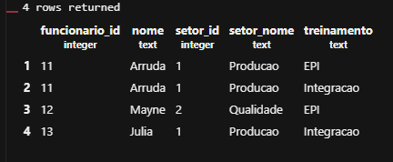
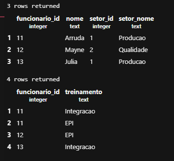
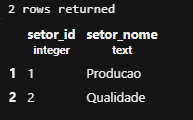
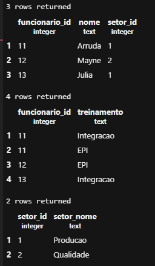

# Normalização de Banco de Dados – Manutec


## 1FN

1- Primeiro, criamos um novo banco de dados:

```sql
CREATE DATABASE manutec;
```

2- Criamos a tabela original:

```sql
CREATE TABLE cadastro_original (
    funcionario_id INTEGER PRIMARY KEY,
    nome TEXT,
    setor_id INTEGER,
    setor_nome TEXT,
    treinamentos TEXT
);
```

3- Inserimos os dados na tabela:

```sql
INSERT INTO cadastro_original VALUES
(11, 'Arruda', 1, 'Producao', 'Integracao;EPI'),
(12, 'Mayne', 2, 'Qualidade', 'EPI'),
(13, 'Julia', 1, 'Producao', 'Integracao');
```

4- Criamos a tabela `cadastro_1fn`, separando os treinamentos pelo ponto e vírgula:

```sql
CREATE TABLE cadastro_1fn AS
SELECT
    funcionario_id,
    nome,
    setor_id,
    setor_nome,
    UNNEST(STRING_TO_ARRAY(treinamentos, ';')) AS treinamento
FROM cadastro_original;
```

5- Adicionamos a chave primária composta por `funcionario_id` e `treinamento`:

```sql
ALTER TABLE cadastro_1fn
ADD PRIMARY KEY (funcionario_id, treinamento);
```

6- Consultamos o resultado após a separação dos treinamentos:

```sql
SELECT * FROM cadastro_1fn
ORDER BY funcionario_id, treinamento;
```

**Print do resultado:**



---

## 2FN

1- Criamos a tabela `funcionarios`, usando DISTINCT para evitar repetir os dados dos funcionários:

```sql
CREATE TABLE funcionarios AS
SELECT DISTINCT
    funcionario_id,
    nome,
    setor_id,
    setor_nome
FROM cadastro_1fn;
```

2- Adicionamos a chave primária da tabela:

```sql
ALTER TABLE funcionarios
ADD PRIMARY KEY (funcionario_id);
```

3- Criamos a tabela `participacoes`, contendo o funcionário e o treinamento:

```sql
CREATE TABLE participacoes AS
SELECT funcionario_id, treinamento
FROM cadastro_1fn;
```

4- Adicionamos a chave primária composta:

```sql
ALTER TABLE participacoes
ADD PRIMARY KEY (funcionario_id, treinamento);
```

5- Adicionamos a chave estrangeira para relacionar as participações aos funcionários:

```sql
ALTER TABLE participacoes
ADD FOREIGN KEY (funcionario_id)
REFERENCES funcionarios(funcionario_id);
```

6- Consultamos as duas tabelas:

```sql
SELECT * FROM funcionarios;

SELECT * FROM participacoes;
```

**Print dos resultados:**



---

## 3FN

O objetivo dessa etapa é separar os setores da tabela de funcionários para evitar repetir o nome do setor em vários registros.

1- Criamos a tabela `setores`, usando DISTINCT para não repetir os setores:

```sql
CREATE TABLE setores AS
SELECT DISTINCT setor_id, setor_nome
FROM funcionarios;
```

2- Adicionamos a chave primária da tabela de setores:

```sql
ALTER TABLE setores
ADD PRIMARY KEY (setor_id);
```

3- Consultamos os setores antes de continuar:

```sql
SELECT * FROM setores;
```

**Print do resultado:**



4- Adicionamos a chave estrangeira em `funcionarios`, relacionando cada funcionário ao seu setor:

```sql
ALTER TABLE funcionarios
ADD FOREIGN KEY (setor_id)
REFERENCES setores(setor_id);
```

5- Exigimos o preenchimento do campo `setor_id`:

```sql
ALTER TABLE funcionarios
ALTER COLUMN setor_id SET NOT NULL;
```

6- Removemos somente a coluna `setor_nome` da tabela `funcionarios`, pois essa informação agora está na tabela `setores`:

```sql
ALTER TABLE funcionarios
DROP COLUMN setor_nome;
```

7- Consultamos as três tabelas finais:

```sql
SELECT * FROM funcionarios;

SELECT * FROM participacoes;

SELECT * FROM setores;
```

**Print dos resultados finais:**


---
