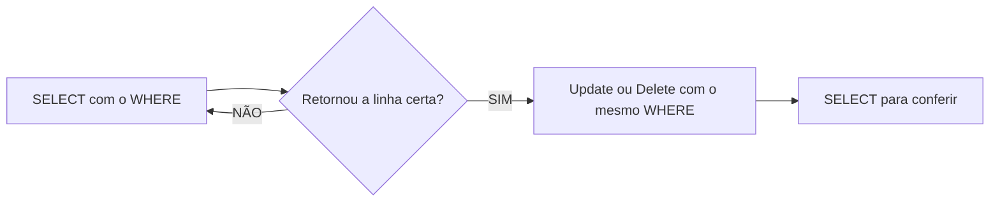

## Aula 05
Para filtrar colunas, utilizamos o comando:
```sql
SELECT nome,populacao FROM maiorescidades;
```

Para filtros de registros, utilizamos o comando:

```sql
SELECT * FROM maiorescidades WHERE populacao < 35000000
```

Para ordenar os dados:

```sql
SELECT nome,populacao FROM maiorescidades
ORDER BY populacao DESC;
```
**UPDATE*: Update ou Delete sem um `WHERE` atinge tods as linhas! Não existe Ctrl+Z 

Fluxo seguro (sempre):



Para UPDATE:
```sql
DATE dados
SET populacao=334000001
WHERE nome='Tóquio'
```
Também é possivel realizar cálculos:
```sql
UPDATE dados
SET populacao= populacao -3
WHERE id = 3;
```
Para DELETE:
```sql
DELETE FROM dados WHERE nome='Délhi'
```

