## Analise de Dados
Para verificar se um banco de dados existe antes de apagar:
```sql
DROP DATABASE IF EXISTS produtos;
```
---

Para criar a tabela:
```sql
 CREATE TABLE produtos(
    id SERIAL PRIMARY KEY,
    nome VARCHAR(100) NOT NULL,
    categoria VARCHAR(50) NOT NULL,
    preco DECIMAL(10,2) NOT NULL,
    estoque INTEGER NOT NULL
 );
```

Adcionando as linhas na tabela:
```sql
INSERT INTO produtos (nome, categoria, preco, estoque) VALUES
('Mouse Óptico USB', 'Periféricos', 50.00, 120),
('Mouse Sem Fio', 'Periféricos', 89.90, 85),
('Mouse Gamer RGB', 'Periféricos', 249.00, 32),
('Teclado ABNT2 USB', 'Periféricos', 120.00, 64),
('Teclado Mecânico Gamer', 'Periféricos', 459.00, 18),
('Teclado Sem Fio Slim', 'Periféricos', 199.00, 40),
('Mousepad Grande', 'Periféricos', 45.00, 150),
('Suporte Ergonômico Notebook', 'Periféricos', 135.00, 28),
('Hub USB 4 Portas', 'Periféricos', 79.00, 95),
('Adaptador USB-C HDMI', 'Periféricos', 159.00, 47),

('Monitor 21,5 Full HD', 'Monitores', 750.00, 22),
('Monitor 24 Full HD IPS', 'Monitores', 950.00, 19),
('Monitor 27 QHD', 'Monitores', 1890.00, 8),
('Monitor 32 4K', 'Monitores', 2790.00, 4),
('Monitor Gamer 144Hz', 'Monitores', 1650.00, 11),
('Suporte Articulado Monitor', 'Monitores', 289.00, 26),

('Notebook Básico 8GB', 'Notebooks', 2890.00, 14),
('Notebook Intermediário 16GB', 'Notebooks', 4500.00, 9),
('Notebook Gamer RTX', 'Notebooks', 7990.00, 3),
('Notebook Ultrafino 14', 'Notebooks', 5300.00, 6),
('Chromebook 11', 'Notebooks', 1790.00, 17),
('Carregador Universal 65W', 'Notebooks', 189.00, 58),

('Impressora Laser Mono', 'Impressão', 800.00, 12),
('Impressora Multifuncional', 'Impressão', 1250.00, 7),
('Impressora Tanque de Tinta', 'Impressão', 1090.00, 10),
('Toner Compatível Preto', 'Impressão', 145.00, 72),
('Cartucho Colorido', 'Impressão', 98.00, 88),
('Papel A4 500 folhas', 'Impressão', 29.90, 240),
('Scanner de Mesa', 'Impressão', 690.00, 5),

('Roteador Wi-Fi 5 Dual Band', 'Redes', 249.00, 35),
('Roteador Wi-Fi 6 AX1500', 'Redes', 459.00, 16),
('Switch 8 Portas Gigabit', 'Redes', 329.00, 21),
('Cabo de Rede Cat6 5m', 'Redes', 35.00, 180),
('Repetidor de Sinal Wi-Fi', 'Redes', 139.00, 54),
('Placa de Rede USB Wi-Fi', 'Redes', 89.00, 66),
('Nobreak 1500VA', 'Redes', 980.00, 6),

('SSD 480GB SATA', 'Armazenamento', 289.00, 45),
('SSD 1TB NVMe', 'Armazenamento', 549.00, 24),
('SSD 2TB NVMe', 'Armazenamento',1090.00, 9),
('HD Externo 1TB', 'Armazenamento', 379.00, 31),
('HD Externo 2TB', 'Armazenamento', 549.00, 15),
('Pen Drive 64GB', 'Armazenamento', 49.90, 200),
('Pen Drive 128GB', 'Armazenamento', 79.90, 110),
('Cartão de Memória 128GB', 'Armazenamento', 99.00, 76),

('Headset Gamer com Microfone', 'Áudio', 250.00, 38),
('Headset Bluetooth', 'Áudio', 329.00, 27),
('Caixa de Som Bluetooth', 'Áudio', 189.00, 49),
('Fone Intra-Auricular', 'Áudio', 69.90, 130),
('Microfone Condensador USB', 'Áudio', 449.00, 13),
('Webcam Full HD 1080p', 'Áudio', 180.00, 41);
```
Para verificar a quantidade de linhas da nossa base de dados:
```sql
SELECT * FROM produtos;
```
---
Para filtrar colunas:
```sql
SELECT nome,preco FROM produtos;
```
---
Para adcionar limite ao filtro:
```sql
SELECT nome,preco FROM produtos LIMIT 10;
```
---
Para verificar quantas categorias existem:
```sql
SELECT DISTINCT categoria FROM produtos;
```
---
Para filtrar preços/faixas de valores:
```sql
SELECT nome,preco FROM produtos WHERE preco > 1000;
```
```sql
SELECT nome,preco FROM produtos WHERE preco >= 0 AND preco <= 500;
```
*OU*
```sql
SELECT nome,preco FROM produtos WHERE preco BETWEEN 0 AND 500;
```
---
Ultilizando o comando *OR* para filtrar duas categorias:
```sql
SELECT nome,preco FROM produtos WHERE categoria = 'Monitores' OR categoria ='Notebooks'
```
--- 
Para consultas desconsiderando letras maíusculas e nome completo que será consultado:
```sql
SELECT nome,preco FROM produtos WHERE nome ILIKE 'mouse%';
```
>% Operador coringa!
---
Para definir ordem decrescente e vice versia:
```sql
SELECT nome,preco FROM produtos WHERE nome ILIKE 'mouse%';
```
## Atividade Prática

### InnerBooks

1. Criando a tabela:
```sql 
CREATE TABLE produtos(
    id SERIAL PRIMARY KEY,
    nome VARCHAR(100) NOT NULL,
    autor VARCHAR(50) NOT NULL,
    preco DECIMAL(10,2) NOT NULL,
    estoque INTEGER NOT NULL,
    genero VARCHAR(50) NOT NULL,
    ano_publicacao NUMERIC(10)
)
```
O que retorna:
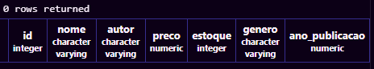

2. Adcionando as linhas:
```sql
-- INSERT INTO produtos (titulo, autor, preco, genero, estoque, ano_publicacao) VALUES
-- -- Romance Brasileiro
-- ('Dom Casmurro',                              'Machado de Assis',           29.90, 'Romance Brasileiro', 45, 1899),
-- ('Memórias Póstumas de Brás Cubas',           'Machado de Assis',           31.90, 'Romance Brasileiro', 38, 1881),
-- ('Quincas Borba',                             'Machado de Assis',           33.90, 'Romance Brasileiro', 14, 1891),
-- ('Esaú e Jacó',                               'Machado de Assis',           32.50, 'Romance Brasileiro', 12, 1904),
-- ('Helena',                                    'Machado de Assis',           27.90, 'Romance Brasileiro', 16, 1876),
-- ('Iracema',                                   'José de Alencar',            24.90, 'Romance Brasileiro', 50, 1865),
...
```
O que nos retorna(+80):
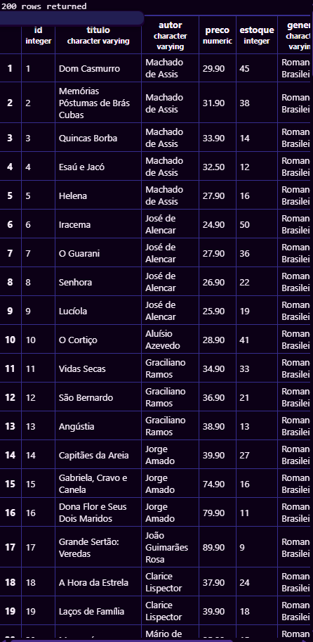
---
Filtramos isso ultilizando:
```sql
SELECT * FROM produtos LIMIT 10;
```
---
O que nos retorna:
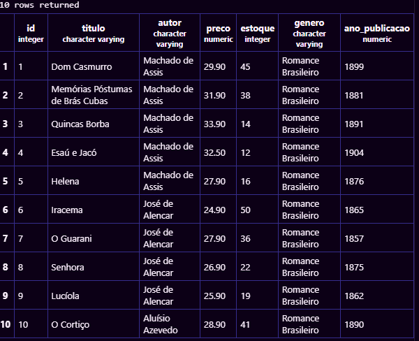
---
 Filtrando mais:
```sql
SELECT titulo,autor,preco FROM produtos;
```

 O que nos retorna:
 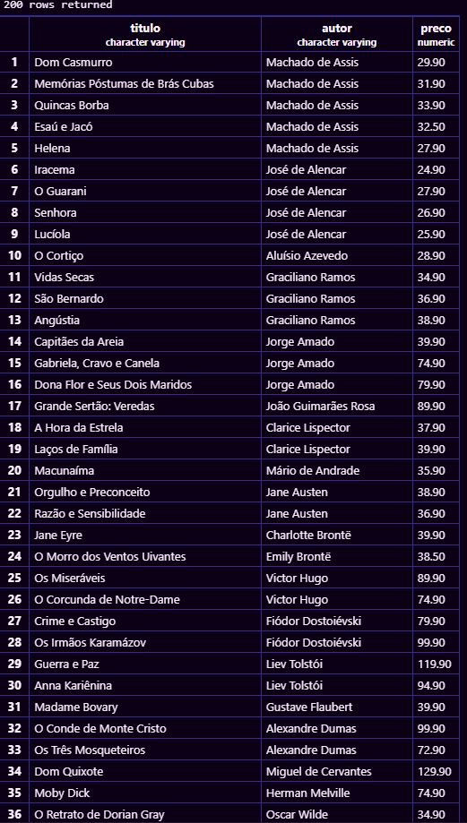
---
Para listar os gêneros destintos em ordem:
```sql
 SELECT DISTINCT genero FROM produtos ORDER BY genero ASC;
 ```
 O que nos retorna:
 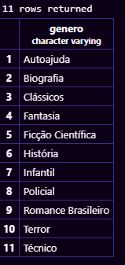
 ---
 Agora filtrando os autores destintos:
 ```sql
 SELECT COUNT(DISTINCT autor) AS quantidade_autores
FROM produtos;
```
O que nos retorna:
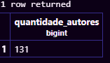
---
Listando os 5 livros mais caros:
```sql
SELECT titulo, preco FROM produtos ORDER BY preco DESC LIMIT 5;
```
O que nos retorna:
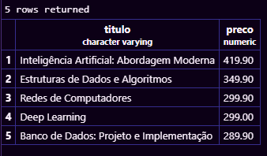
---
Listando os 5 com menor estoque:
```sql
SELECT titulo, estoque FROM produtos ORDER BY estoque ASC LIMIT 5;
```
O que nos retorna:
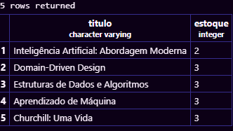
---
### Filtros numéricos:

Mostrando os livros do gênero Técnico:
```sql
SELECT titulo, estoque FROM produtos WHERE genero = 'Técnico';
```
O que nos retorna:
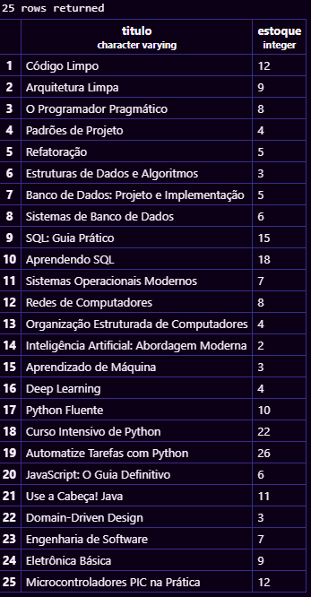
---
Mostrando os livros que tem preço > R$200,00
```sql
SELECT titulo,preco FROM produtos WHERE preco > 200;
```
O que nos retorna:
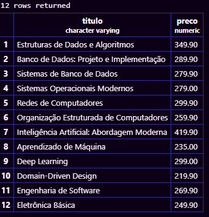
---
Mostrando os livros que tem preço entre R$ 40,00 e R$ 70,00
```sql
SELECT titulo, preco FROM produtos WHERE preco BETWEEN 40 AND 70;
```
O que nos retona:

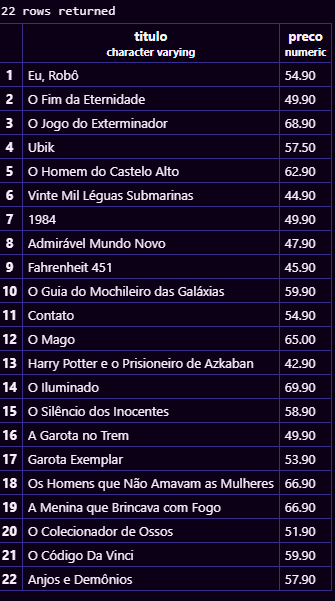
---
Livros que necessitam de reposição urgente:
```sql
SELECT titulo,estoque FROM produtos WHERE estoque < 5;
```
O que nos retorna:

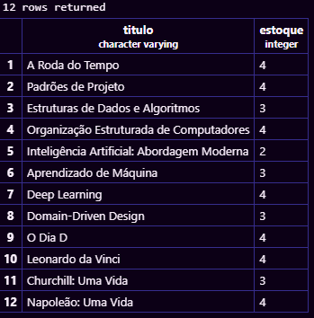
---
Livros publicados antes de 1900 em ordem crescente
```sql
SELECT titulo,ano_publicacao FROM produtos WHERE ano_publicacao < 1900 ORDER BY ano_publicacao ASC;
```
O que nos retorna

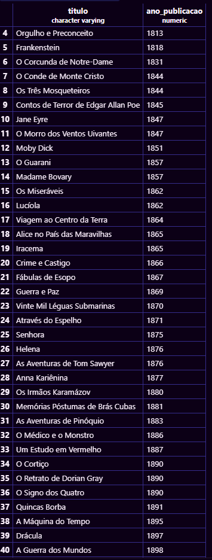
---
Livros publicados entre 2010 e 2020
```sql
SELECT titulo,ano_publicacao,genero FROM produtos WHERE ano_publicacao BETWEEN 2010 AND 2020 ORDER BY ano_publicacao ASC;
```
O que nos retorna:

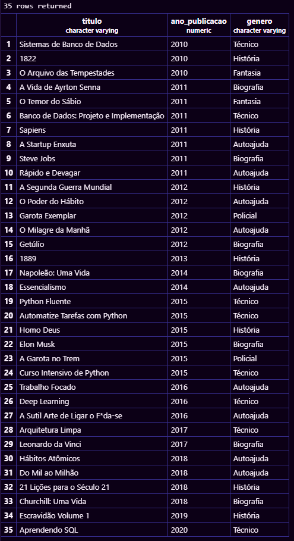

---
## Assim finalizamos a analise do banco de dados da InnerBooks